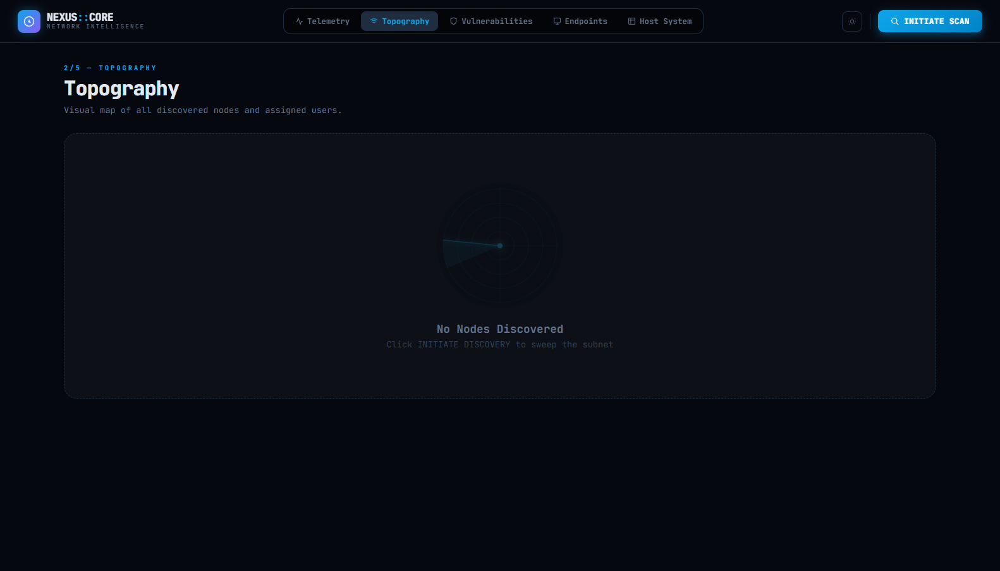
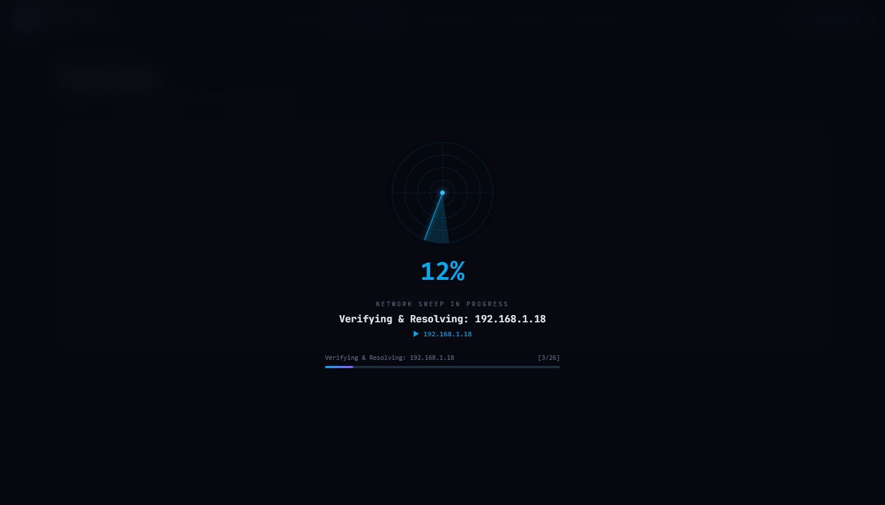
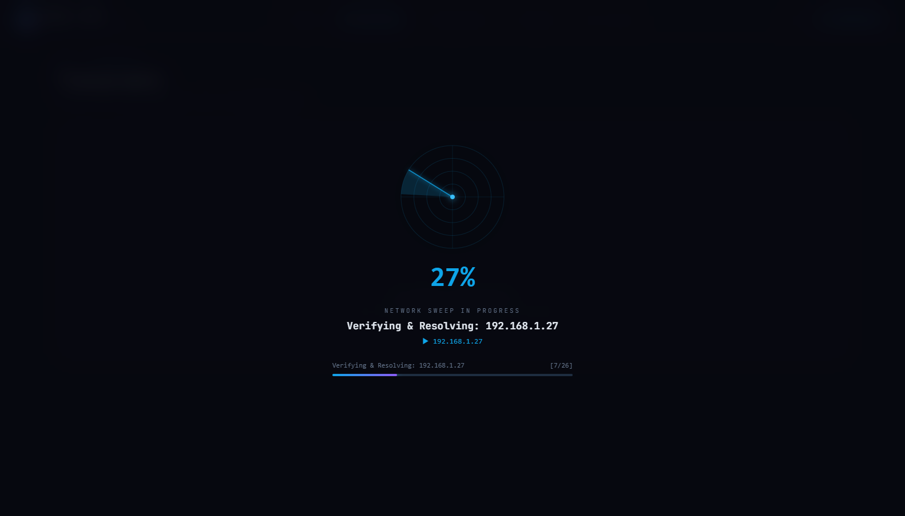

# LAN-Scanner

<p align="center">
  
  
  
  
  
</p>

A high-performance full-stack Network Radar & LAN Scanner dashboard. Perform intelligent local ARP sweeps, resolve hostnames, identify hardware vendors via MAC OUI lookup, stream real-time TX/RX bandwidth telemetry, and monitor host hardware metrics.

---

## 📸 Hero Preview

<p align="center">
  
</p>

## 🖼️ UI Snapshot Gallery

<p align="center">
  
  
</p>

---

## ✨ Features

- 📡 **Intelligent ARP & Ping Sweep** - Fast concurrent discovery of active IP nodes, MAC addresses, and resolved hostnames.
- 🏷️ **MAC OUI Vendor Identification** - Automatic hardware manufacturer lookup across connected devices.
- 📊 **Real-Time Telemetry Streaming** - Continuous live TX/RX throughput monitoring powered by Server-Sent Events (SSE).
- 🖥️ **Host System Diagnostics** - Instant CPU processor stats, RAM allocation, storage metrics, and OS telemetry.
- ⚡ **Local Interface Speed Testing** - Measure actual bandwidth throughput directly from network counters.
- 🌓 **Cyber Radar Console** - Dark and light theme support with animated radar sweep indicators and clean node telemetry cards.

---

## 🛠️ Tech Stack

- **Frontend**: React 19, Vite, Axios, Lucide Icons
- **Backend**: FastAPI, Uvicorn (Asynchronous Python REST API & SSE)
- **Networking & Diagnostics**: Python `socket`, `subprocess` (ARP / ICMP), `psutil`, MAC OUI database

---

## 🚀 Quick Start

### 1. Clone the repository
```bash
git clone https://github.com/soorajstudio/LAN-Scanner.git
cd LAN-Scanner
```

### 2. Start Backend (FastAPI)
```bash
cd backend
pip install -r requirements.txt
uvicorn main:app --reload --port 8000
```

### 3. Start Frontend (React + Vite)
```bash
cd ../frontend
npm install
npm run dev
```

Open [http://localhost:5173](http://localhost:5173) in your browser.

---

## 📄 License

This project is licensed under the MIT License — see the [LICENSE](LICENSE) file for details.

Developed with ❤️ by [Sooraj Studio](https://github.com/soorajstudio).
